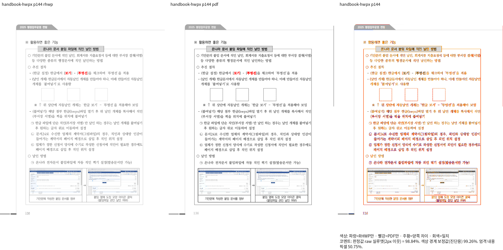
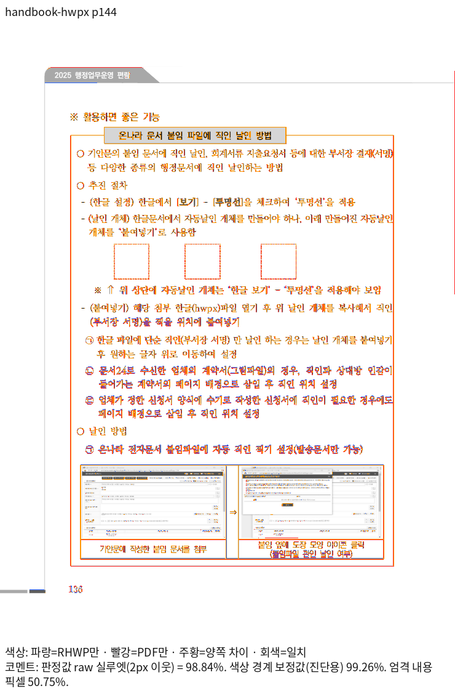
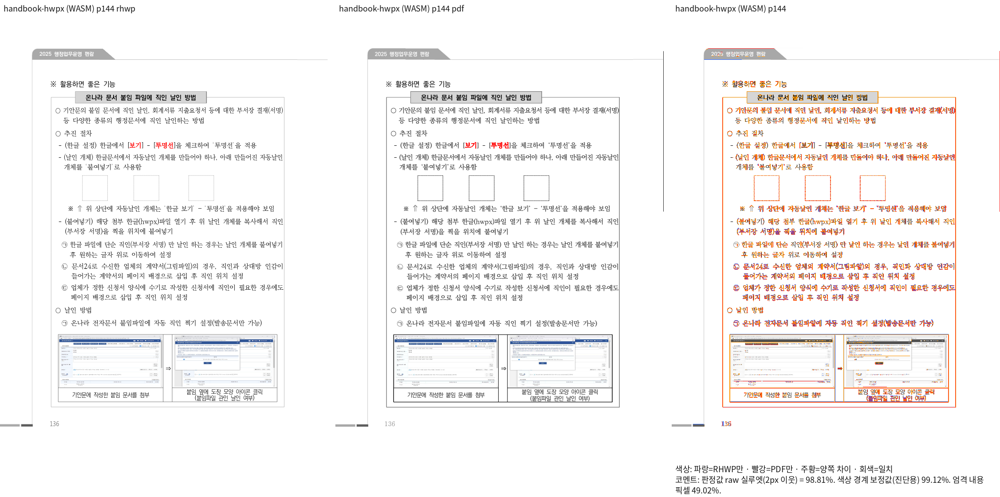
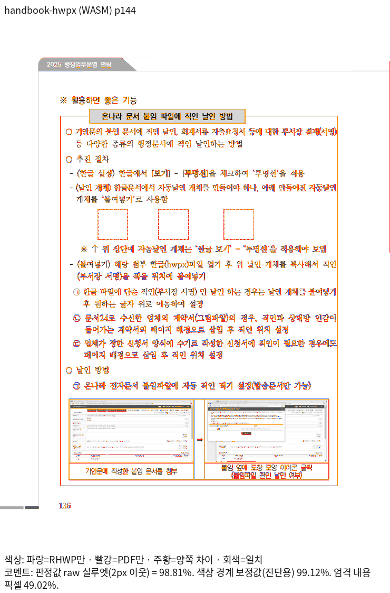

# Issue #8151 편람 144쪽 정합성 및 전체 페이지 변화 검증

## 상태

144쪽은 Native/fresh WASM raw 98% 이상과 독립 Print 확대 판독을 확인했다. 기존 절대 좌표 검사의 근거와 바깥여백 관계 검사를 보완 중이다. 전체 페이지 비교에서 4쪽의 raw 하락이 남아 있으므로 **raw 무하락 또는 모든 페이지 개선 완료로 보고하지 않는다.**

## 입력과 source

- Issue: https://github.com/edwardkim/rhwp/issues/8151
- base: `2e087a5b4bc1515ad877e8020b30114639a59392`
- 후보 runtime: `d81b8b4410779017d50a8891caa6a83ebec994d6`
- HWPX: `samples/2025 행정업무운영 편람(최종).hwpx`, SHA-256 `c6dd7e847a99f219681afc5a29c80a9665c04df9cda4d820a3350d739664fdf6`
- 독립 Print: `pdf/2025 행정업무운영 편람(최종)-hwpx-kopub-2024.pdf`, SHA-256 `299cb2d994bba8b63f78b681bd74580286e298f25689b4ff4f40c66c54bfa85e`, 383쪽
- 대조군: 같은 편람 HWP와 `pdf/2025 행정업무운영 편람(최종)-hwp-kopub-2024.pdf`
- 실제 producer SHA·해시·바이트는 [producer-integrity.tsv](producer-integrity.tsv). base WASM의 `3cb5a4c...` runtime 소스는 고정 base와 바이트가 같다.
- profile print, compat2024, 96dpi, 기본 Native Skia/최적화 fresh WASM Canvas, 같은 시스템 글꼴 공급이다. base/head WASM font-catalog SHA-256도 같다.

## 144쪽

| 형식 | backend | base raw % | 후보 raw % |
| --- | --- | ---: | ---: |
| handbook-hwpx | native | 97.88889 | 98.84256 |
| handbook-hwpx | wasm | 97.85593 | 98.81191 |
| handbook-hwp | native | 97.88860 | 98.84240 |
| handbook-hwp | wasm | 97.85582 | 98.81185 |

독립 Print의 도장 상자 왼쪽 선 중심은 139.289/225.956/318.616pt, 윗변은 271.654pt다. 96dpi 환산 x는 185.718667/301.274667/424.821333px, y는 362.205333px다. bbox 원점과 stroke 중심 차이를 구분해 ±2px로 보호한다.

원본은 구역 3/문단 71의 표 1723619577, r2c0 문단 4에 도장 표 3개를 가진다. 크기는 4251HU 정사각형, 가로 offset은 4868/13553/22830HU, 바깥 왼여백은 283HU다. 기존 inline x override가 공통 중첩 앵커의 바깥여백·정렬 처리를 우회했다. 별도 override를 제거하고 단 원점·저장 offset·바깥여백을 기존 공통 계산에서 한 번 적용한다. 확정 세로 원점과 흐름 전진 규칙은 유지한다.

도장 세 개의 가로 순서·공통 y·사이 간격·주변 안내문, 하단 예시 표·쪽 소속을 PDF와 Native/fresh WASM에서 직접 대조했다. 전후 차이를 숨기거나 tolerance·DPI·마스크를 변경하지 않았다.

## 144쪽 직접 출력

| backend | review | overlay |
| --- | --- | --- |
| native |  |  |
| wasm |  |  |

## 전체 페이지 TSV와 변화

각 입력·backend에서 383/383쪽, 누락 0쪽, 90% 미만 0쪽이다. 전후 모두 같은 원본·독립 Print·compat·DPI·글꼴·backend로 새로 산출했다. 과거 제출 시점의 다른 환경 TSV와 섞지 않았다.

| 입력 | backend | base | 후보 | 전체 페이지 차이 |
| --- | --- | --- | --- | --- |
| handbook-hwpx | native | [원문](tsv/base/native/handbook-hwpx.tsv) | [원문](tsv/head/native/handbook-hwpx.tsv) | [383쪽 차이](tsv/delta/handbook-hwpx-native-page-delta.tsv) |
| handbook-hwpx | wasm | [원문](tsv/base/wasm/handbook-hwpx.tsv) | [원문](tsv/head/wasm/handbook-hwpx.tsv) | [383쪽 차이](tsv/delta/handbook-hwpx-wasm-page-delta.tsv) |
| handbook-hwp | native | [원문](tsv/base/native/handbook-hwp.tsv) | [원문](tsv/head/native/handbook-hwp.tsv) | [383쪽 차이](tsv/delta/handbook-hwp-native-page-delta.tsv) |
| handbook-hwp | wasm | [원문](tsv/base/wasm/handbook-hwp.tsv) | [원문](tsv/head/wasm/handbook-hwp.tsv) | [383쪽 차이](tsv/delta/handbook-hwp-wasm-page-delta.tsv) |

네 조합 모두 개선 2쪽(116·144), 하락 4쪽(85·86·87·179), 동일 377쪽이다. 0.1%p 이상 하락은 0쪽이며 최대 하락은 WASM 86쪽 0.02427%p다. 이 수치로 raw 하락 사실을 삭제하거나 무하락으로 바꾸어 보고하지 않는다. 상세 분해와 실제 좌표는 [변화·하락 분석](page-change-analysis.md)에 있다.

## 회귀와 검증

- 기존 #3820 좌표 검사: 크기로 고르던 대상을 원본 소유 정보로 식별하고, compat2024와 독립 Print x/y ±2px로 수정한다. 상자 수·공통 y·원본 크기 관계를 유지한다.
- 신규 `tests/cases/issue_8151_nested_overlay_outer_margin.rs`: 원본과 왼쪽 바깥여백 0 대조군의 이동량을 원본 283HU와 비교한다. 흐름/쪽수·y·표 크기 보존과 표 사이 비겹침도 검사한다.
- 같은 신규 Rust 검사 소스를 보존한 base/head Native rlib에 직접 연결해 실행했다. base는 이동량 0 대 원본 3.773333px로 의도한 FAIL(exit 101), head는 1 PASS(exit 0)다. 이는 Cargo 자동 suite 실행과 구분한다.
- 자동 수집은 `regression_suite_003::issue_8151_nested_overlay_outer_margin`으로 확인했다. 정식 자동 수집에서 기존 2건과 신규 1건 모두 PASS다. Native root Clippy, WASM32 Clippy, fmt, manifest 고정 base 비교도 통과했다. Native Skia 광범위·workspace lint·전체 회귀와 #8148 전 입력 비교는 진행 중이다.

작업 로그·원시 render tree·producer 사본은 ignored `output/pr-review/handbook-hwpx-p144-20261022/`에 둔다. 폰트 바이너리·중간 SVG·실행 로그는 공개 증적에 넣지 않는다.

## 사용자 범위 조정 및 추가 영향 확인

전쪽 100% 정합성 보정은 후속으로 미루고 현재 144쪽 개선을 PR로 준비한다. 제출 전에 #8148에서 실제 검증한 HWP/HWPX 67개와 PDF 대조군 5개를 기준 병합과 현재 후보에서 같은 환경으로 재출력해, 문서별·페이지별 개선과 하락 폭 및 쪽수·내용 보존을 확인 중이다. 미완료 조건을 동일·통과로 표시하지 않는다. 현재 단계에서 다른 문서의 무영향 확인이나 PR 준비 완료를 주장하지 않는다.
