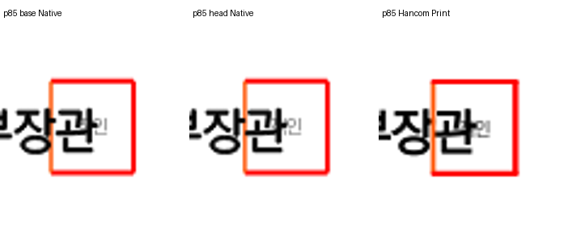
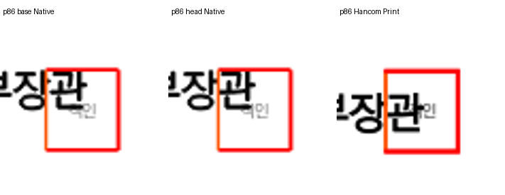
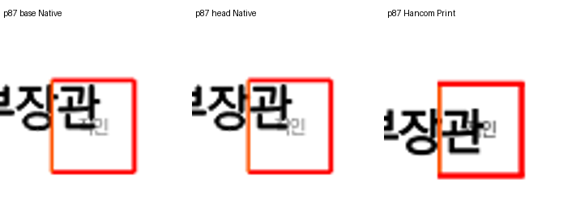
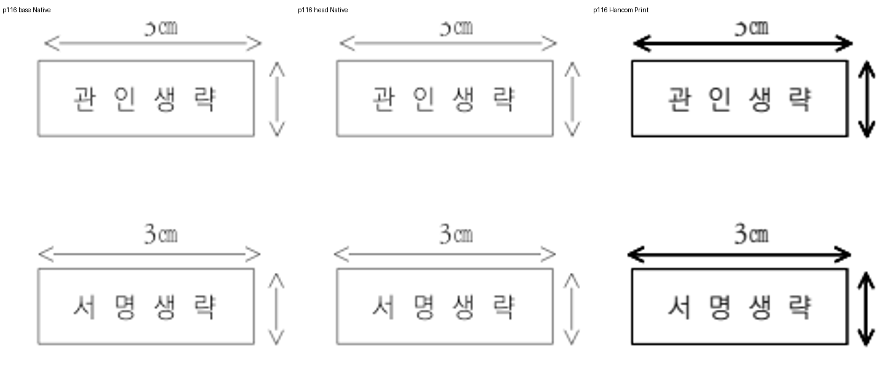
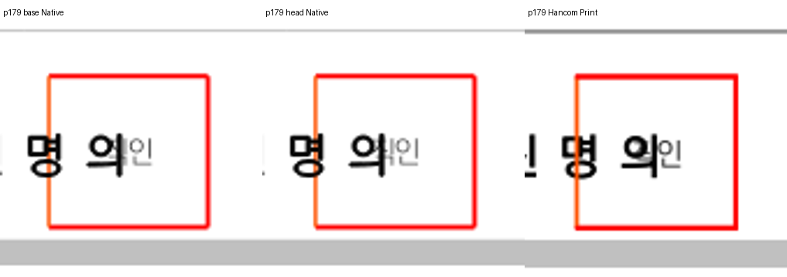

# 편람 144쪽 보정의 전쪽 변화 및 하락 원인 조사

- base: `2e087a5b4bc1515ad877e8020b30114639a59392`
- 후보 runtime: `d81b8b4410`
- Native/fresh WASM의 두 형식 각 383쪽 비교를 완료했다.
- 기존 제출 시점의 TSV를 섞지 않고 이번에 같은 환경에서 생성한 base/head를 비교했다.
- 수치 하락과 배치 개선은 별도 기록하며 이 조사 문서로 완료·승인을 판정하지 않는다.

## Native 변경 페이지 (fresh WASM 전체 비교도 완료)

| 입력 | 쪽 | base raw % | 후보 raw % | 차이 %p |
| --- | ---: | ---: | ---: | ---: |
| handbook-hwpx | 85 | 99.70466 | 99.70449 | -0.00017 |
| handbook-hwpx | 86 | 96.06312 | 96.04151 | -0.02161 |
| handbook-hwpx | 87 | 98.62968 | 98.61784 | -0.01184 |
| handbook-hwpx | 116 | 99.09958 | 99.22614 | 0.12656 |
| handbook-hwpx | 144 | 97.88889 | 98.84256 | 0.95367 |
| handbook-hwpx | 179 | 99.77816 | 99.77803 | -0.00013 |
| handbook-hwp | 85 | 99.70469 | 99.70452 | -0.00017 |
| handbook-hwp | 86 | 96.06296 | 96.04135 | -0.02161 |
| handbook-hwp | 87 | 98.62960 | 98.61775 | -0.01185 |
| handbook-hwp | 116 | 99.10114 | 99.23389 | 0.13275 |
| handbook-hwp | 144 | 97.88860 | 98.84240 | 0.95380 |
| handbook-hwp | 179 | 99.77818 | 99.77805 | -0.00013 |

## HWPX 하락 픽셀의 분해

| 쪽 | 이전 내용 합집합 | 후보 내용 합집합 | 이전 불일치 | 후보 불일치 |
| ---: | ---: | ---: | ---: | ---: |
| 85 | 101577 | 101520 | 300 | 300 |
| 86 | 48287 | 48276 | 1901 | 1911 |
| 87 | 112091 | 112071 | 1536 | 1549 |
| 179 | 114044 | 113978 | 253 | 253 |

85·179쪽은 불일치 마스크가 전후 완전히 같고 합집합 분모만 작아졌다. 더 많은 내용 픽셀이 같은 위치에서 겹쳐 분모가 감소해 raw 비율은 소폭 낮아졌다. 지표 식이나 임계값을 바꾸지 않았다.

86쪽은 새 불일치 21개/해소 11개, 87쪽은 새 불일치 16개/해소 3개다. 새로 불일치가 된 모든 좌표의 Native RGB는 보정 전후 모두 (255,255,255)로 동일하다. 도장 표와 글자만 오른쪽으로 옮겨져 PDF의 기존 글자 픽셀에 대한 2px 이웃 지원이 달라졌다. 이 위치에 새로운 문자 누락이나 본문 이동이 생긴 것은 아니다.

| 쪽 | 이전 표 x px | 후보 표 x px | 독립 Print 왼쪽 선 중심 px |
| ---: | ---: | ---: | ---: |
| 85 | 404.0 | 405.9 | 405.4813 |
| 86 | 419.6 | 421.4 | 420.9854 |
| 87 | 402.3 | 404.2 | 403.7240 |
| 179 | 373.1 | 374.9 | 374.4747 |

모든 이동한 직인 표의 왼쪽 위치는 독립 Print에 가까워졌다. 기존 본문과 Print의 세로 배치 차이는 전후 모두 있으며 이번 가로 보정의 새 본문 이동으로 분류하지 않는다. 원인 계층의 후보는 저장된 가운데 정렬 글줄과 중첩 overlay 점유 높이의 구분이며, 별도 구현 검증 전에는 확정하지 않는다.

## 같은 영역의 직접 비교

## fresh WASM 변경 페이지

| 입력 | 쪽 | base raw % | 후보 raw % | 차이 %p |
| --- | ---: | ---: | ---: | ---: |
| handbook-hwpx | 85 | 99.69485 | 99.69468 | -0.00017 |
| handbook-hwpx | 86 | 96.03674 | 96.01247 | -0.02427 |
| handbook-hwpx | 87 | 98.69302 | 98.68206 | -0.01096 |
| handbook-hwpx | 116 | 99.19411 | 99.23262 | 0.03851 |
| handbook-hwpx | 144 | 97.85593 | 98.81191 | 0.95598 |
| handbook-hwpx | 179 | 99.77512 | 99.77499 | -0.00013 |
| handbook-hwp | 85 | 99.69482 | 99.69465 | -0.00017 |
| handbook-hwp | 86 | 96.03899 | 96.01472 | -0.02427 |
| handbook-hwp | 87 | 98.69307 | 98.68210 | -0.01097 |
| handbook-hwp | 116 | 99.17707 | 99.21334 | 0.03627 |
| handbook-hwp | 144 | 97.85582 | 98.81185 | 0.95603 |
| handbook-hwp | 179 | 99.77427 | 99.77414 | -0.00013 |
